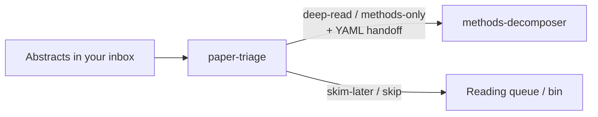

# Scholar Screen Skills

**English** | [中文](README.zh-CN.md)

Two agent skills for reading social-science research — for Claude Code, Codex and other tools that support the Agent Skills format (a folder with a `SKILL.md`).

1. **Screen with a rubric, not a vibe** — `paper-triage`
2. **Decompose identification before algebra** — `methods-decomposer`



| Skill | You paste | You get |
|---|---|---|
| [`paper-triage`](skills/paper-triage/) | Title + abstract, or a batch of them | Scores on claim / design / relevance / payoff, a verdict (deep-read · methods-only · skim-later · skip) with confidence, and a handoff for the next skill |
| [`methods-decomposer`](skills/methods-decomposer/) | A paper's Methods section | An identification map, an **estimand ↔ estimator alignment** check, every formula in three layers, design-specific checks (DID, IV, RDD, synthetic control, text/ML, networks, panel FE) |

## See it in action

All papers below are invented. Excerpts are trimmed; full outputs are in each skill's `examples/`.

### paper-triage — "Triage these five"

| # | Paper | Verdict | Total | Relevance | Conf. | One-line why |
|---|---|---|---|---|---|---|
| 1 | Carbon markets & firm emissions | deep-read | 8/8 | 2 | high | A staggered pilot rollout with a heterogeneity-robust estimator backs a causal claim scoped to covered firms. |
| 3 | Synthetic-DID estimator | methods-only | 7/8 | 2 | high | The estimator is the contribution, but it is benchmarked only against plain TWFE. |
| 2 | LLM policy-stringency measure | methods-only | 6/8 | 2 | high | The measure is the contribution; the abstract mentions no validation of the LLM scores (待核). |
| 4 | "Social media causes polarization" | skip (weak design) | — | 1 | high | It claims "causes" from one cross-section with controls only. |
| 5 | Mice and dietary fibre | skip (off-topic) | — | 0 | high | Lab biology, not social science. |

Then: *"I'm writing about the effects of China's environmental policies — re-rank."* → the table is re-scored against that goal, with changed rows marked. Full run: [`batch-table.md`](skills/paper-triage/examples/batch-table.md).

<details>
<summary><b>The handoff block it writes for a keeper</b></summary>

```yaml
# handoff to methods-decomposer
handoff_version: 1
paper: "Coastal Distance, Environmental Regulation, and Foreign Investment in Chinese Cities"
verdict: deep-read
confidence: high
abstract: |
  Do stricter environmental regulations deter foreign direct investment? …
claim: "A one-standard-deviation increase in environmental regulation stringency reduces FDI inflows by 12% on average across all cities (abstract sentence 4; causal, stated as general)."
design_sniff: "quasi-experimental — 2SLS instrumenting regulation stringency with coastal distance × national ventilation-based pollution targets across 280 cities."
red_flags:
  - "Exclusion: coastal distance plausibly affects FDI directly (trade costs, ports, market access, income)."
  - "LATE sold as an average effect 'across all cities' — check monotonicity and who the compliers are."
  - "'Overturning' prior work — strong claim resting on one instrument."
unknowns:
  - "First-stage strength (F-statistic) not reported in the abstract."
  - …
questions:
  - "How strong is the first stage, and do placebo or falsification tests (e.g. pre-period FDI, non-pollution-sensitive sectors) support exclusion?"
  - "Which cities are the compliers, and how far does the 12% LATE generalise to 'all cities'?"
  - …
depth: quick
data: "280 Chinese prefecture-level cities · 2005–2018 · N not stated"
reader_goal: "not stated"
```

Trimmed; full block: [`handoff-iv.md`](skills/paper-triage/examples/handoff-iv.md).
</details>

### methods-decomposer — "What does this actually identify?"

The pasted Methods: 11 of 31 provinces adopt a policy in 2014, 2016 and 2018; the paper runs `Y_pt = α_p + λ_t + β · RiverChief_pt + X_pt'θ + ε_pt` and says insignificant leads "confirm" parallel trends.

> As written, β is not a clean effect for anyone: it is a two-way fixed-effects (TWFE) weighted average of many before/after comparisons across three adoption cohorts, some of which use already-treated provinces as controls. …
>
> **Estimand ↔ estimator alignment — misaligned: staggered adoption estimated by single-dummy TWFE.**
> With adoption in 2014, 2016 and 2018, β mixes 2×2 comparisons, including ones where earlier adopters act as controls for later ones; with heterogeneous or growing effects some weights can be negative. The paste names no heterogeneity-robust estimator and no decomposition of β.

It goes on to copy the formula exactly as written, flag equation (3) as cited but not shown, and list the design checks: pre-trends treated as proof, clustering below the assignment level, only 11 treated clusters. Full run: [`did-quick.md`](skills/methods-decomposer/examples/did-quick.md). An IV decomposition and an OCR-damaged formula: [`iv-full.md`](skills/methods-decomposer/examples/iv-full.md), [`uncertain-parsing.md`](skills/methods-decomposer/examples/uncertain-parsing.md).

## Honest boundaries

- No literature search — these skills work on papers you already have.
- Never invents equations, findings, quotations or citations; missing text stays missing ("not stated").
- Not peer review — triage is a personal reading decision, not a referee report.
- Journal prestige and citation counts never enter a score.
- Every example and fixture in this repo is **invented**.

## Install

Each skill is a self-contained folder under `skills/` (with its own `references/`, `templates/`, `examples/`). Copy or link the folders you want.

**Claude Code** (all projects):

```bash
git clone https://github.com/liuxiaoyuu/scholar-screen-skills.git
cp -R scholar-screen-skills/skills/* ~/.claude/skills/
```

For one project only, copy into `<project>/.claude/skills/` instead.

**Codex:**

```bash
cp -R scholar-screen-skills/skills/* ~/.codex/skills/
```

**Other tools that support Agent Skills** (Cursor and others): copy each folder into that tool's skills directory — check its docs for the path. If you use the open-source `skills` CLI:

```bash
npx skills add liuxiaoyuu/scholar-screen-skills
```

Start a new session after installing so the skills load.

## Try it in five minutes

1. Open `evals/fixtures/A-batch-five-abstracts.md`, copy everything below the title, and say **"Triage these five."** Compare with `skills/paper-triage/examples/batch-table.md`.
2. Ask for the handoff on the top paper, then paste it with `evals/fixtures/C-methods-iv.md` and say **"Full decomposition please."** Compare with `skills/methods-decomposer/examples/iv-full.md`.

## Test it

`evals/` has invented fixtures with known traps, a checklist of what a good answer must catch (`expected.md`), and `check_outputs.py` for mechanical checks (legal verdict labels, complete handoffs, formulas copied verbatim from the paste). See `evals/README.md`.

## Languages

Triggers and answers work in English and Chinese; each skill answers in the language you write in.

## License and citation

MIT — see `LICENSE`. To cite, see `CITATION.cff`. Background and authorship: `PROVENANCE.md`.
