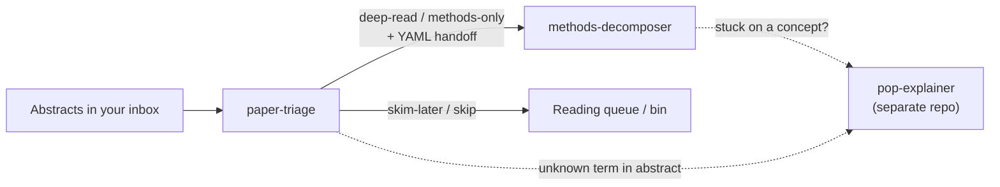

# Scholar Screen Skills

Two agent skills for reading social-science research — for Claude Code, Codex and other tools that support the Agent Skills format (a folder with a `SKILL.md`).

1. **Screen with a rubric, not a vibe** — `paper-triage`
2. **Decompose identification before algebra** — `methods-decomposer`

Companion: [**pop-explainer**](https://github.com/liuxiaoyuu/pop-explainer) teaches any concept with a misconception-reversal story — handy when an abstract or a Methods section uses a term you don't know.



| Skill | You paste | You get |
|---|---|---|
| [`paper-triage`](skills/paper-triage/) | Title + abstract, or a batch of them | Scores on claim / design / relevance / payoff, a verdict (deep-read · methods-only · skim-later · skip) with confidence, and a handoff for the next skill |
| [`methods-decomposer`](skills/methods-decomposer/) | A paper's Methods section | An identification map, an **estimand ↔ estimator alignment** check, every formula in three layers, design-specific checks (DID, IV, RDD, synthetic control, text/ML, networks, panel FE) |

## Honest boundaries

- No literature search — these skills work on papers you already have.
- Never invents equations, findings, quotations or citations; missing text stays missing ("not stated").
- Not peer review — triage is a personal reading decision, not a referee report.
- Journal prestige and citation counts never enter a score.
- Every example and fixture in this repo is **invented**.

## Install

Each skill is a self-contained folder under `skills/` (with its own `references/`, `templates/`, `examples/`). Copy or link the folders you want.

**Claude Code** (all projects):

```bash
git clone https://github.com/liuxiaoyuu/scholar-screen-skills.git
cp -R scholar-screen-skills/skills/* ~/.claude/skills/
```

For one project only, copy into `<project>/.claude/skills/` instead.

**Codex:**

```bash
cp -R scholar-screen-skills/skills/* ~/.codex/skills/
```

**Other tools that support Agent Skills** (Cursor and others): copy each folder into that tool's skills directory — check its docs for the path. If you use the open-source `skills` CLI:

```bash
npx skills add liuxiaoyuu/scholar-screen-skills
```

Start a new session after installing so the skills load.

## Try it in five minutes

1. Open `evals/fixtures/A-batch-five-abstracts.md`, copy everything below the title, and say **"Triage these five."** Compare with `skills/paper-triage/examples/batch-table.md`.
2. Ask for the handoff on the top paper, then paste it with `evals/fixtures/C-methods-iv.md` and say **"Full decomposition please."** Compare with `skills/methods-decomposer/examples/iv-full.md`.
3. Stuck on "LATE"? Install the companion [pop-explainer](https://github.com/liuxiaoyuu/pop-explainer) and say **"explain LATE like a story"**.

## Test it

`evals/` has invented fixtures with known traps, a checklist of what a good answer must catch (`expected.md`), and `check_outputs.py` for mechanical checks (legal verdict labels, complete handoffs, formulas copied verbatim from the paste). See `evals/README.md`.

## Languages

Triggers and answers work in English and Chinese; each skill answers in the language you write in.

## License and citation

MIT — see `LICENSE`. To cite, see `CITATION.cff`. Background and authorship: `PROVENANCE.md`.
