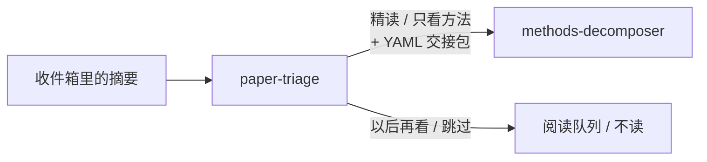

# Scholar Screen Skills

[English](README.md) | **中文**

两个帮你读社科论文的 Agent Skill，适用于 Claude Code、Codex，以及其他支持 Agent Skills 格式（一个带 `SKILL.md` 的文件夹）的工具。

1. **用打分表筛论文，不靠感觉**：`paper-triage`
2. **先拆识别策略，再看公式**：`methods-decomposer`



| Skill | 你贴什么 | 你得到什么 |
|---|---|---|
| [`paper-triage`](skills/paper-triage/) | 标题 + 摘要，一篇或一批 | 结论、设计、相关性、价值四项打分，一个判定（精读 · 只看方法 · 以后再看 · 跳过）和把握度，以及交给下一个 skill 的交接包 |
| [`methods-decomposer`](skills/methods-decomposer/) | 一篇论文的 Methods 部分 | 识别策略图、**目标量 ↔ 估计量对齐**检查、每个公式的三层解读、按设计类型的专项检查（DID、IV、RDD、合成控制、文本 / ML、网络、面板固定效应） |

## 效果展示

下面的论文全部是虚构的，节选有删减；完整输出在各 skill 的 `examples/` 里。示例是用英文提问的，所以输出也是英文；用中文提问，回答就是中文。

### paper-triage：「帮我筛一下这五篇」

| # | 论文 | 判定 | 总分 | 相关性 | 把握 | 一句话理由 |
|---|---|---|---|---|---|---|
| 1 | 碳市场与企业排放 | deep-read | 8/8 | 2 | high | 交错试点 + 对异质性稳健的估计量，撑得起限定在被覆盖企业上的因果结论 |
| 3 | 合成 DID 估计量 | methods-only | 7/8 | 2 | high | 贡献在估计量本身，但只和普通 TWFE 比过 |
| 2 | 用 LLM 测政策严格度 | methods-only | 6/8 | 2 | high | 贡献在测量本身；摘要没提 LLM 打分怎么验证（待核） |
| 4 | 「社交媒体导致极化」 | skip (weak design) | — | 1 | high | 只凭一次横截面调查加控制变量，就说「导致」 |
| 5 | 小鼠与膳食纤维 | skip (off-topic) | — | 0 | high | 实验室生物学，不是社科 |

接着说「我在写中国环境政策的效果，按这个重新排」，它会按你的方向重新打分，并标出哪几行变了。完整过程见 [`batch-table.md`](skills/paper-triage/examples/batch-table.md)。

<details>
<summary><b>它给值得读的论文写的交接包</b></summary>

```yaml
# handoff to methods-decomposer
handoff_version: 1
paper: "Coastal Distance, Environmental Regulation, and Foreign Investment in Chinese Cities"
verdict: deep-read
confidence: high
abstract: |
  Do stricter environmental regulations deter foreign direct investment? …
claim: "A one-standard-deviation increase in environmental regulation stringency reduces FDI inflows by 12% on average across all cities (abstract sentence 4; causal, stated as general)."
design_sniff: "quasi-experimental — 2SLS instrumenting regulation stringency with coastal distance × national ventilation-based pollution targets across 280 cities."
red_flags:
  - "Exclusion: coastal distance plausibly affects FDI directly (trade costs, ports, market access, income)."
  - "LATE sold as an average effect 'across all cities' — check monotonicity and who the compliers are."
  - "'Overturning' prior work — strong claim resting on one instrument."
unknowns:
  - "First-stage strength (F-statistic) not reported in the abstract."
  - …
questions:
  - "How strong is the first stage, and do placebo or falsification tests (e.g. pre-period FDI, non-pollution-sensitive sectors) support exclusion?"
  - "Which cities are the compliers, and how far does the 12% LATE generalise to 'all cities'?"
  - …
depth: quick
data: "280 Chinese prefecture-level cities · 2005–2018 · N not stated"
reader_goal: "not stated"
```

有删减，完整版见 [`handoff-iv.md`](skills/paper-triage/examples/handoff-iv.md)。交接包的字段名固定用英文，方便程序读取。
</details>

### methods-decomposer：「这篇到底识别了什么？」

贴进去的 Methods：31 个省里有 11 个在 2014、2016、2018 年分批引入一项政策；论文跑的是 `Y_pt = α_p + λ_t + β · RiverChief_pt + X_pt'θ + ε_pt`，并说前置项不显著「证实」了平行趋势。

> As written, β is not a clean effect for anyone: it is a two-way fixed-effects (TWFE) weighted average of many before/after comparisons across three adoption cohorts, some of which use already-treated provinces as controls. …
>
> **Estimand ↔ estimator alignment — misaligned: staggered adoption estimated by single-dummy TWFE.**
> With adoption in 2014, 2016 and 2018, β mixes 2×2 comparisons, including ones where earlier adopters act as controls for later ones; with heterogeneous or growing effects some weights can be negative. The paste names no heterogeneity-robust estimator and no decomposition of β.

大意：按原文写法，β 不是任何人的干净效应，而是三批采纳省份之间许多前后对比的加权平均，其中一些对比拿已经采纳的省份当对照组。**目标量 ↔ 估计量对齐的结论是不对齐**：交错采纳却用了单一处理哑变量的 TWFE，效应随批次或时间变化时，部分权重甚至可能是负的。

之后它会原样抄录公式，指出公式 (3) 只提到、没给出，并列出设计专项检查：把前置项不显著当证明、聚类层级低于处理分配层级、处理组只有 11 个省。完整过程见 [`did-quick.md`](skills/methods-decomposer/examples/did-quick.md)。IV 的完整拆解、OCR 损坏公式的处理，分别见 [`iv-full.md`](skills/methods-decomposer/examples/iv-full.md) 和 [`uncertain-parsing.md`](skills/methods-decomposer/examples/uncertain-parsing.md)。

## 诚实边界

- 不搜文献：只处理你手上已有的论文。
- 不编造公式、结论、引文或参考文献；原文没写的就是没写（"not stated"）。
- 不是同行评审：筛选只是你个人的阅读决定，不是审稿意见。
- 期刊名气和引用数永远不进分数。
- 仓库里所有示例和测试材料都是**虚构的**。

## 安装

每个 skill 都是 `skills/` 下的独立文件夹（自带 `references/`、`templates/`、`examples/`），复制或链接你想用的就行。

**Claude Code**（所有项目可用）：

```bash
git clone https://github.com/liuxiaoyuu/scholar-screen-skills.git
cp -R scholar-screen-skills/skills/* ~/.claude/skills/
```

只想在某个项目里用，就复制到 `<项目>/.claude/skills/`。

**Codex：**

```bash
cp -R scholar-screen-skills/skills/* ~/.codex/skills/
```

**其他支持 Agent Skills 的工具**（Cursor 等）：把文件夹复制到该工具的 skills 目录，具体路径请查它的文档。如果你用开源的 `skills` 命令行工具：

```bash
npx skills add liuxiaoyuu/scholar-screen-skills
```

装好后新开一个会话，skill 才会加载。

## 五分钟上手

1. 打开 `evals/fixtures/A-batch-five-abstracts.md`，复制标题以下的全部内容，说**「帮我筛一下这五篇」**，再和 `skills/paper-triage/examples/batch-table.md` 对比。
2. 对排第一的论文要交接包，然后把交接包和 `evals/fixtures/C-methods-iv.md` 一起贴进去，说**「完整拆一下」**，再和 `skills/methods-decomposer/examples/iv-full.md` 对比。

## 测试

`evals/` 里有埋了陷阱的虚构测试材料、一份好答案必须抓到哪些问题的清单（`expected.md`），以及做机械检查的 `check_outputs.py`：判定标签是否合法、交接包是否完整、公式是否从原文逐字抄录。说明见 `evals/README.md`。

## 语言

中英文触发词都支持；你用什么语言提问，skill 就用什么语言回答。

## 许可与引用

MIT 许可，见 `LICENSE`。引用方式见 `CITATION.cff`。来源与署名说明见 `PROVENANCE.md`。
